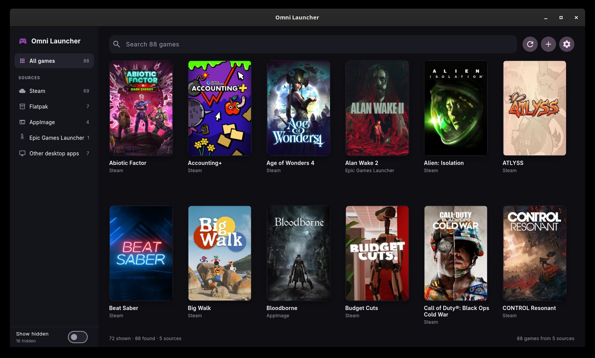
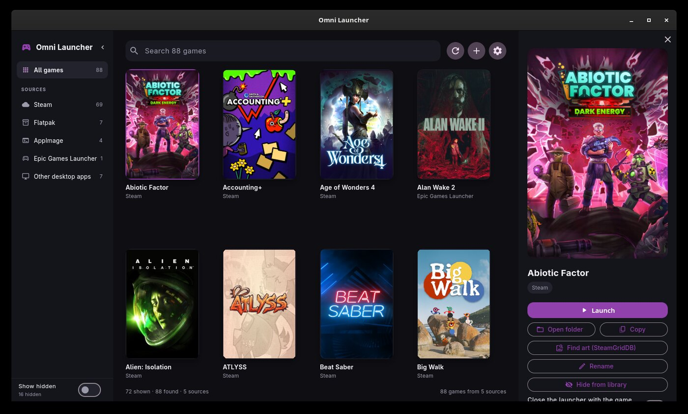
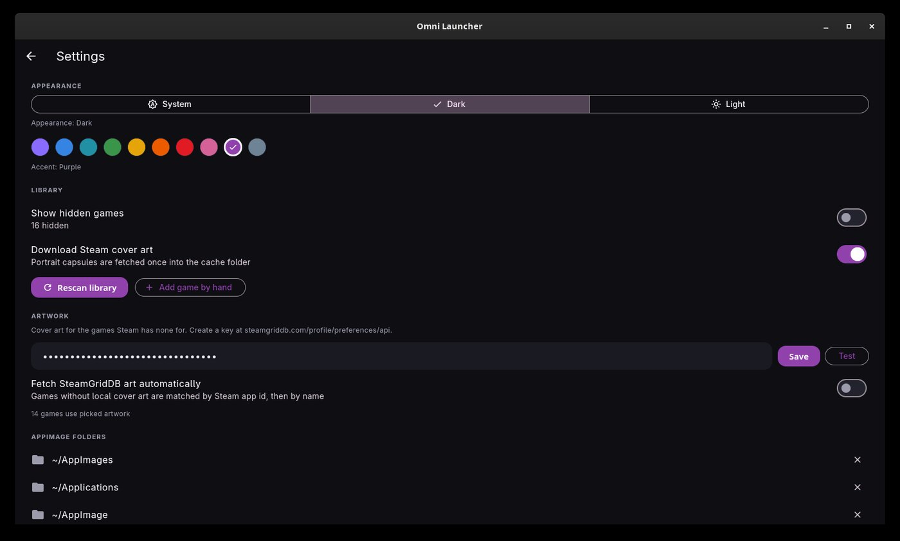
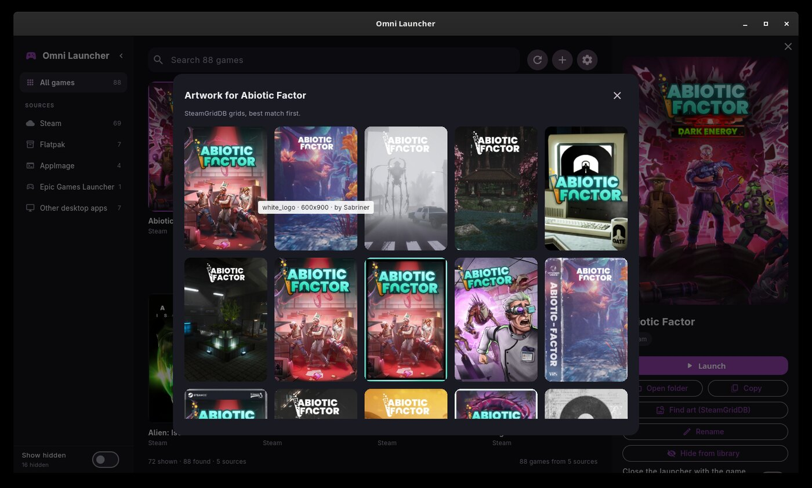

# Omni Launcher

One window for every game on your machine, whatever packaging it came in.
A Flutter desktop launcher in the spirit of Playnite and Cartridges: a cover
wall first, details on demand.



## What it finds

| Source | Detected from | Started with |
| --- | --- | --- |
| Steam | `steamapps/libraryfolders.vdf` + `appmanifest_*.acf` (installed only) | `steam -applaunch <appid>` |
| Flatpak | exported `.desktop` entries with `Categories=Game` | `flatpak run <app-id>` |
| AppImage | AppImage magic bytes (`41 49 02` at offset 8) in the configured folders | the file itself |
| Heroic / Epic / GOG / Amazon | Heroic's `legendaryConfig`/`gog_store`/`nile_config`, standalone `legendary`/`nile` | `xdg-open heroic://launch/<id>` |
| Epic Games Launcher | the native launcher's data root | `xdg-open com.epicgames.launcher://apps/…` |
| Lutris | `~/.config/lutris/games/*.yml` | `lutris lutris:rungameid/<id>` |
| Faugus | Faugus' `games.json` (flatpak or native) | `faugus-launcher --game <title>` |
| Desktop entries | `*.desktop` with `Categories=Game` outside flatpak exports | `gtk-launch <file>` |
| By hand | the `manual` list in the config | your command |

## What it does beyond launching



* **Cover art** from Steam's own library cache, or from SteamGridDB with your
  own API key: portrait posters on a 168x252 tile, whatever shape the window is.
* **A sidebar that folds** down to an icon rail, for the source list you set up
  once and then never look at again.
* **Games that are also Steam shortcuts** (RetroDECK, for instance) are
  launched through Steam, which is what gives them Steam Input and the overlay.
* **Playtime and last played**, per game. Only time that was actually observed
  is counted, so a launcher that dies mid-game cannot invent hours.
* **Recently played**, on a shelf above the wall: the last ten games you
  started, newest first, each with how much and how recently you played it.
  The shelf follows the wall's filters and steps aside while you search.
* **Plugins**: a folder with a `plugin.json` in it and a program the launcher
  runs, JSON in and JSON out, in any language. **Settings → Plugins** is a
  store: it lists what the launcher's repository offers, installs one into your
  plugin folder and removes it again. HowLongToBeat is in the list, and ships
  with the launcher too.
* **Rename** any entry. The new name is what the wall, the search and the
  SteamGridDB lookup use, so an awkward name can be turned into the title
  SteamGridDB knows. The discovered name is kept, so it can be reset.
* **Hide** entries you never launch, **close the launcher with the game** for
  launchers that outlive their game, and add games by hand.
* **Appearance**: System / Dark / Light, plus an accent colour from the GNOME
  basic palette. The window's title bar follows the palette too.



Settings holds the theme mode, the accent colour, the SteamGridDB key, the
AppImage folders, hidden games and hand-added games.

## Install

### Flatpak

```sh
flatpak install --user --from \
  https://github.com/PuppyCodingBadly/omni-launcher/releases/latest/download/io.github.PuppyCodingBadly.OmniLauncher.flatpakref
```

That installs from the project's flatpak repository, so `flatpak update` picks
up later releases. Each release also carries `OmniLauncher-x86_64.flatpak`, a
standalone bundle of that release's build, for installing without a repository:

```sh
flatpak install --user ./OmniLauncher-x86_64.flatpak
```

### From source

Needs the Flutter SDK and a GTK3 development toolchain (clang, cmake, ninja,
pkg-config, libgtk-3-dev). On an immutable distribution, build inside a
container that has those:

```sh
git clone https://github.com/PuppyCodingBadly/omni-launcher.git
cd omni-launcher
flutter build linux --release
./dev.sh              # runs the build from this checkout, nothing installed
```

`./install.sh` is for a real install instead: it copies the bundle to
`~/.local/opt/omni-launcher`, links it as `~/.local/bin/omni-launcher` and
writes a desktop entry and an icon, which is what puts it in the app grid.
`./dev.sh` runs a build you are working on where it is, so nothing outside the
checkout is touched.

## Use

Launch "Omni Launcher" from your app grid. Click a tile to select it, double
click (or the Play button on hover) to start the game; with a tile focused,
`Enter` launches it and `Space` selects it. `Ctrl+F` search, `Ctrl+R` rescan,
`Esc` close the details panel.

The star in a game's detail panel pins it as a favorite: favorites sort first
on the wall and keep a star on their cover. The same pin is in each tile's
actions menu.

The sidebar filters by source and folds to an icon rail with the chevron in its
header: the same filters, each with its label and count in the tooltip. It
stays folded next time, and hidden games live behind *Show hidden*, which the
rail keeps too.

The detail panel keeps *Launch* and the game's facts to itself; *Open folder*,
*Copy* (the exact argv), *Find art*, *Rename*, *Hide* and *Remove* live behind
the cog in its header. *Close the launcher with the game* stays on the panel,
since it is a setting rather than an action. Under those, each plugin gets a
section with the button that asks it about this game, and what it answered.

## Configuration and files

| Path | Contents |
| --- | --- |
| `~/.config/omnilauncher-flutter/config.json` | hidden games, AppImage folders, hand-added games, appearance, the folded sidebar, SteamGridDB key, pinned artwork, renames |
| `~/.cache/omnilauncher-flutter/games.json` | last scan, for an instant start |
| `~/.cache/omnilauncher-flutter/covers/` | downloaded Steam capsules and picked SteamGridDB art |
| `~/.local/state/omnilauncher-flutter/launch.log` | every launch, with argv, plus the game's own output |
| `~/.local/state/omnilauncher-flutter/playtime.json` | played time and last played per game |
| `~/.cache/omnilauncher-flutter/plugin_answers.json` | what the plugins answered, per plugin and game |
| `~/.local/share/omnilauncher-flutter/plugins/` | the plugins themselves, one folder each |

Nothing is uploaded anywhere. The launcher's own network use is cover art:
Steam's CDN, and SteamGridDB when you set a key. A plugin does whatever its
author wrote, which is why you get to see what you are running.

The flatpak keeps its files in those same places: it uses the host's XDG
folders rather than the sandbox's own, so a native build and the flatpak share
one set of hidden games, renames and playtime.

## SteamGridDB

SteamGridDB has no anonymous tier, so it needs your own API key
(steamgriddb.com → Preferences → API). Paste it under **Settings → Artwork**,
press *Test*, then either turn on **Fetch SteamGridDB art automatically** or use
**Find art** on a single game to browse the candidates (thumb, style, size,
author) and pin one. Picked art is stored per game, so it survives rescans.



## Plugins

A plugin teaches the launcher one more thing about your games. The one that
ships with it is a HowLongToBeat lookup: how long the game takes, main story
through completionist, next to the game's own facts in the detail panel.

A plugin is a folder with a `plugin.json` in it and a program it names:

```
~/.local/share/omnilauncher-flutter/plugins/
  howlongtobeat/
    plugin.json
    hltb.py
```

```json
{
  "id": "howlongtobeat",
  "name": "HowLongToBeat",
  "description": "How long the game is.",
  "author": "PuppyCodingBadly",
  "action": "Look up on HowLongToBeat",
  "command": ["python3", "hltb.py"],
  "version": 1
}
```

The launcher runs `command` in the plugin's own folder and writes one JSON
object to its stdin:

```json
{
  "action": "lookup",
  "game": {
    "id": "steam:427410",
    "key": "427410",
    "name": "Abiotic Factor",
    "source": "steam",
    "path": "/games/abiotic",
    "cwd": null,
    "command": ["steam", "-applaunch", "427410"],
    "extra": {"appid": "427410"}
  }
}
```

`source` is `search` when the lookup came from the settings page instead of
from a game. The plugin answers with one JSON object on its stdout:

```json
{
  "fields": [
    {"label": "Main story", "value": "54h 32m"},
    {"label": "Main + extra", "value": "75h 28m"}
  ],
  "url": "https://howlongtobeat.com/game/149774"
}
```

`fields` are shown in that order, `url` (optional) becomes a link to the page
the answer came from, and `{"error": "…"}` says why there is no answer. Every
other way a plugin can go wrong — a crash, a non-zero exit, silence for 30
seconds, more than 256 KiB of output, a reply that is not JSON — is reported in
the panel as that plugin's answer, so a broken plugin is visible rather than
silent. Answers are cached per plugin and game
(`~/.cache/omnilauncher-flutter/plugin_answers.json`), so selecting a game
again does not ask the site again.

### The store

**Settings → Plugins** reads a catalogue from the launcher's own repository and
offers what it lists: *Install* unpacks a plugin into your plugin folder and
the launcher starts using it straight away — the plugin gets its section in the
detail panel, with the button that asks it about the game you have selected.
*Update* appears when the catalogue has a higher version than the one you have,
and the bin beside it removes the plugin's folder. The catalogue is read from

```
https://raw.githubusercontent.com/PuppyCodingBadly/omni-launcher/main/plugins/index.json
```

and each entry names a `.zip` beside it, so the list and the archives it points
at always come from the same commit. A plugin that is only on your machine —
one you wrote, or one you dropped in by hand — is listed under the catalogue as
*installed here, and not in the list*.

A plugin runs as you, on the host, outside the flatpak sandbox: treat one you
did not write as a program you are running, because that is exactly what it is.

### Writing one

A plugin lives in `plugins/<id>/` in this repository: its files, and a
`plugin.json` naming the program to run. `plugins/build.sh` turns every folder
there into the archive the store hands out and rewrites `plugins/index.json`
from the manifests, so publishing a plugin is a pull request that adds the
folder and the output of that script.

The shipped HowLongToBeat plugin is installed into your plugin folder at start
up as well, so it works before anything has been downloaded; a copy you have
edited stays as it is until the shipped copy's `version` in its manifest is
higher.

## Packaging it yourself

`flatpak-flutter.yml` is the manifest that is written by hand. `flatpak-flutter`
turns it into `io.github.PuppyCodingBadly.OmniLauncher.yml` — the manifest that
is actually built — and into the `generated/` folder that manifest reads: the
Flutter SDK, its engine artifacts and every pub package as sources, so the build
itself needs no network.

```sh
git clone https://github.com/TheAppgineer/flatpak-flutter
./flatpak-flutter/flatpak-flutter.py flatpak-flutter.yml
```

Run that again whenever the dependencies or the Flutter version change, and
commit what it writes. `flatpak/` holds the AppStream metadata and a build
script, and `flathub.json` keeps the Flathub build on x86_64, the architecture
the engine artifacts are verified on.

```sh
flatpak install --user flathub org.flatpak.Builder \
    org.freedesktop.Sdk//26.08 org.freedesktop.Sdk.Extension.llvm22//26.08
flatpak/build.sh
```

The LLVM extension is required rather than optional: Flutter's Linux build
hard-codes `CC=clang`/`CXX=clang++` and the base freedesktop SDK only ships gcc.

The permissions it asks for, and why:

| Permission | Why |
| --- | --- |
| `~/.config`, `~/.cache`, `~/.local/state`, `~/.local/share` + `/omnilauncher-flutter` | the launcher's own config, cache, cover art and plugins, kept on the host so a native build and the flatpak share one library |
| `~/.steam:ro`, `~/.local/share/Steam:ro`, `~/.config/lutris:ro`, `~/.local/share/lutris:ro`, `~/.config/heroic:ro`, `~/.config/legendary:ro`, `~/.config/nile:ro`, `~/.local/share/faugus-launcher:ro`, `~/.local/share/com.epicgames.eglv2:ro` | the launchers whose libraries it reads — read-only, because a game is started on the host, not from in here |
| `~/.var/app/{com.valvesoftware.Steam,net.lutris.Lutris,com.heroicgameslauncher.hgl,io.github.Faugus.faugus-launcher}:ro` | the same launchers, installed as flatpaks |
| `~/.local/share/applications:ro` | the desktop entries that advertise games |
| `~/AppImages:ro`, `~/Applications:ro`, `~/AppImage:ro`, `~/Games:ro`, `~/Downloads:ro`, `~/.local/bin:ro` | the folders AppImages are looked for in by default — read-only, because an AppImage that is not executable yet is chmodded on the host side |
| `/mnt:ro`, `/run/media:ro` | Steam libraries and AppImage folders on other drives |
| `/opt:ro` | the last of the default AppImage folders |
| `host-os:ro` | the host's own desktop entries and icons, where the games that are not flatpaks advertise themselves |
| `--talk-name=org.freedesktop.Flatpak` | launching a game means running the host's `steam`/`flatpak`/`xdg-open`/`lutris` through `flatpak-spawn --host` |
| `--share=network` | cover art |
| `--socket=wayland`, `--socket=fallback-x11`, `--share=ipc`, `--device=dri` | a GTK window with GPU rendering |

Not `--filesystem=home`: an AppImage folder outside the list above is not
reachable from inside the flatpak, which is the price of asking for the
narrowest set of paths that still finds everything a default install has.

One honest caveat: `--talk-name=org.freedesktop.Flatpak` plus
`flatpak-spawn --host` means the sandbox is filesystem namespacing, not a
security boundary for what the launcher deliberately runs — a game, a plugin,
or the AppImage it just chmodded all execute on the host as you.

Sharing it with someone else: send them the `.flatpak` file, serve
`flatpak/repo` over the network and hand over a `.flatpakref` whose `Url=`
points at you, or push a `v*` tag, and `.github/workflows/flatpak.yml` builds
the bundle, publishes the repository and the landing page in `site/` to
`gh-pages`, and attaches the bundle plus the generated `.flatpakref` to the
release.

## License

MIT. See [LICENSE](LICENSE).
